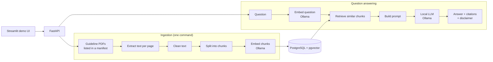

# Architecture (v0)

A modular monolith: one Python package with clear modules, one PostgreSQL database for metadata and vectors, and one local model server. Everything runs on a single laptop. This is the target design; modules are added phase by phase.

## Data flow

## Modules

| Module (in `src/clinical_guideline_rag/`) | Responsibility | Phase |
| --- | --- | --- |
| `text_utils`, `loading` | Extract and clean page text | 1–2 |
| `models` | Shared data structures such as `Chunk` | 1 |
| `storage` | Database schema and queries | 3 |
| `embeddings` | Calls to the local embedding model | 3 |
| `retrieval` | Finding the chunks relevant to a question | 4, 6 |
| `generation` | Prompt building and calls to the local LLM | 4 |
| `api` | REST endpoints | 5 |
| `eval` | Evaluation runner and metrics | 6 |
| `agents` | Agent workflow and its tools | 7 |

## Initial data model

| Table | Main columns |
| --- | --- |
| `documents` | id, guideline, title, version_year, source_url, licence |
| `chunks` | id, document_id, page, chunk_index, text, embedding, embedding_model |
| `query_logs` | id, question, retrieved_chunk_ids, model, latency_ms, answer, created_at |

## Runtime environment
- Development inside WSL2 (Ubuntu) on Windows.
- Ollama runs as a background service inside WSL2, on the RTX 5060 GPU.
- PostgreSQL + pgvector runs in Docker, with a named volume for its data.
- From Phase 8, Docker Compose starts the whole stack with one command.

## Decisions
See [`docs/adr/`](adr/) for the reasoning behind the main choices.